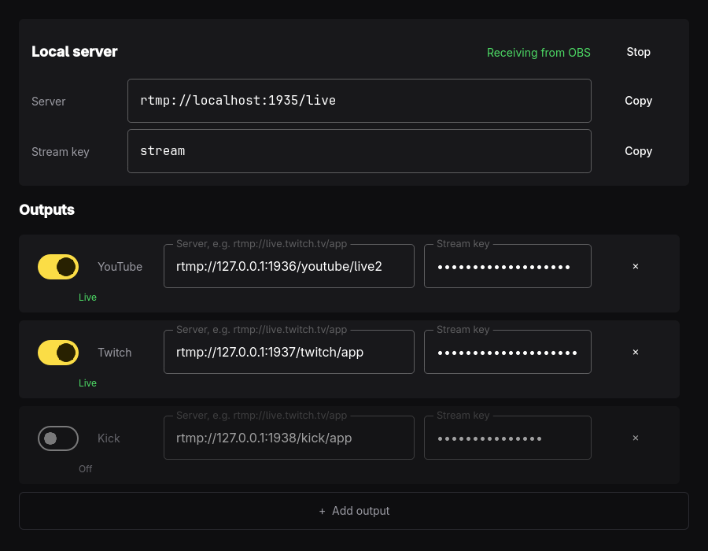
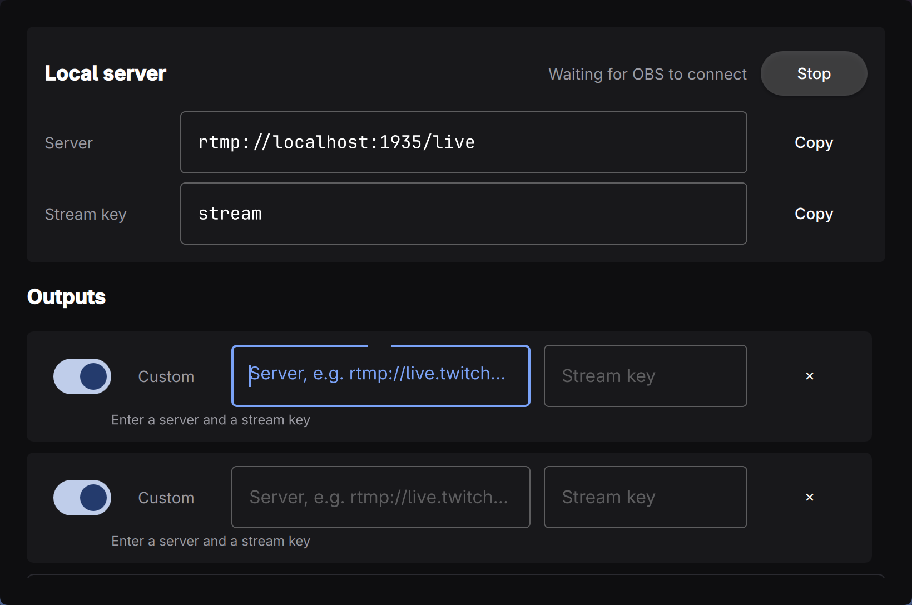

# Stream All



Stream to every platform at once, from a single OBS stream. Stream All runs a
small local server for OBS to connect to, and passes what it receives on to
every destination you add: YouTube, Twitch, Kick, Rumble, or any other RTMP
address.

It is one window. The local server is at the top; below it is a row per
destination, with a plus at the end to add another.

## Set it up

1. In OBS, open **Settings > Stream**, pick **Custom…** as the service, and
   copy the two values from the top of Stream All:

   | OBS field | Value |
   |-----------|-------|
   | Server | `rtmp://localhost:1935/live` |
   | Stream Key | `stream` |

2. In Stream All, press **+ Add output** (or `Ctrl+N`) and fill in a
   destination: the **server** and the **stream key** your platform gives you.
   Each platform shows both on its stream setup page, for example
   `rtmp://a.rtmp.youtube.com/live2` for YouTube or `rtmp://live.twitch.tv/app`
   for Twitch.

3. Start streaming in OBS. Each output goes from *Waiting* to *Connecting…* to
   *Live* as it reaches its platform.



Outputs can be switched on and off, edited, added, and removed while you are
live; the others are not interrupted. An output that fails shows why in its row
and retries every five seconds without affecting the rest.

## One stream, not many

Stream All does not re-encode. It copies the stream OBS sends, unchanged, to
each destination, so it uses almost no CPU and adds almost no delay, and every
platform receives exactly the same video. That means OBS has to send something
every platform accepts: H.264 video and AAC audio, a keyframe interval of 2
seconds, and a bitrate within the lowest limit among your destinations.

## Your stream keys

A stream key lets anyone who has it broadcast on your channel, so Stream All
does not leave them in a file. Each key is stored in the desktop keyring
(Omarchy's `gnome-keyring`) through `secret-tool`, which keeps it encrypted
with your login. The config file, `~/.config/stream-all/outputs.json`, holds
only each output's server and on/off switch.

- Keys are masked in the window.
- Removing an output removes its key from the keyring.
- If the keyring is locked or missing, the window says so and nothing is
  written to disk in its place.
- A config from before keys moved to the keyring is migrated the first time it
  is opened.
- While an output is running, its key is part of that output's ffmpeg command
  line, so another user on the same machine could read it with `ps`. On a
  personal desktop that is rarely a concern, but you should know. ffmpeg has no
  way to take an RTMP key from anywhere else.

The ingest key (`stream`) is the same for everyone and is not a secret; it only
lets OBS find the local server.

## Shortcuts

| Key | Action |
|-----|--------|
| `Space` | Start or stop the local server |
| `Ctrl+N` | Add an output |
| `Enter` / `Esc` | Leave a text field, so the keys below work again |
| `?` | Show the shortcuts |
| `Q` | Quit (asks first when you are live) |

Clicking empty space also leaves a text field. Typing letters into a field
never triggers a shortcut.

## Troubleshooting

- **"Address already in use" at the top:** another program, or a second Stream
  All, is using port 1935. Close it; Stream All keeps retrying.
- **An output says it stopped:** the message under it is ffmpeg's. Stream keys
  are removed from it before it is shown. A wrong key or a platform that is not
  expecting you yet is the usual cause.
- **"The keyring is not available":** unlock it, or make sure `gnome-keyring`
  is running.
- **ffmpeg or secret-tool not found:** install them with
  `omarchy-pkg-add ffmpeg libsecret`.

Stream All never leaves ffmpeg running behind it: quitting, `kill`, `kill -9`,
or a crash all stop every process it started, so the port is free again for
the next launch.

## Install

Once it is in the Omarchy package repository:

```sh
omarchy-pkg-add stream-all
```

Until then, or to run your own changes, build it from source with
`bin/install` (below).

## Build

```sh
bin/build      # qmake6 + make into build/stream-all
bin/test       # the Qt Test suite, offscreen
bin/install    # builds the Arch package and installs it (app launcher entry included)
```

`packaging/omarchy-pkgs/` holds the recipe for the Omarchy package
repository, which builds from a tagged GitHub release.

Needs `qt6-base`, `qt6-declarative`, `qt6-wayland`, `ffmpeg`, and `libsecret`
(plus `gnome-keyring` to hold the keys), which an Omarchy install already
has. The window follows the Omarchy accent, Hyprland's corner
rounding, and the language picked under Setup > Language (English, Danish,
German, Spanish, and French so far).

## License

MIT. The theme and translator are adapted from Omacut, Monologue, and Hype by
David Heinemeier Hansson.
